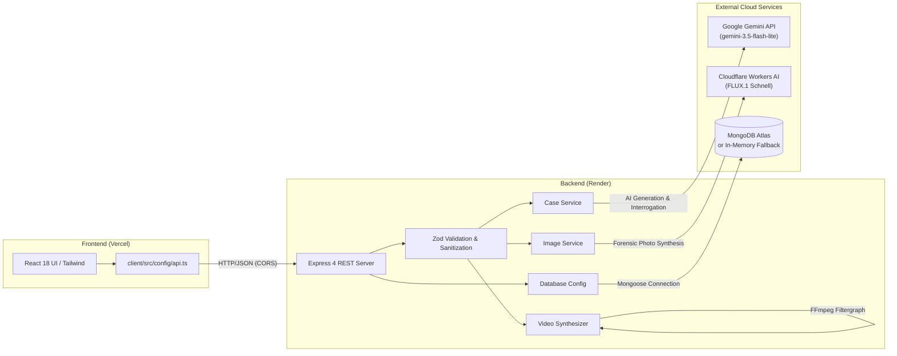

# AI Mystery Room

[](https://react.dev/)
[](https://www.typescriptlang.org/)
[](https://vitejs.dev/)
[](https://tailwindcss.com/)
[](https://nodejs.org/)
[](https://expressjs.com/)
[](https://www.mongodb.com/)
[](https://ai.google.dev/)
[](https://developers.cloudflare.com/workers-ai/)
[](https://vercel.com/)
[](https://render.com/)

**AI Mystery Room** is an immersive, noir-inspired detective investigation game and full-stack web application. Players step into the role of a lead detective to solve procedural crime mysteries by examining forensic evidence exhibits, analyzing encrypted communication intercepts, inspecting surveillance camera feeds, questioning suspects in real time, and formulating evidence-backed accusations.

---

## Table of Contents

- [Live Demo](#live-demo)
- [Key Features](#key-features)
- [Screenshots](#screenshots)
- [Technology Stack](#technology-stack)
- [System Architecture](#system-architecture)
- [Project Structure](#project-structure)
- [Getting Started](#getting-started)
  - [Prerequisites](#prerequisites)
  - [Installation](#installation)
  - [Environment Configuration](#environment-configuration)
  - [Running Locally](#running-locally)
- [Environment Variables](#environment-variables)
- [API Documentation](#api-documentation)
- [Testing and Build](#testing-and-build)
- [Deployment Guide](#deployment-guide)
  - [Backend on Render](#backend-on-render)
  - [Frontend on Vercel](#frontend-on-vercel)
- [Troubleshooting](#troubleshooting)
- [Security and Solution Shielding](#security-and-solution-shielding)
- [Future Improvements](#future-improvements)
- [Contributing](#contributing)
- [License](#license)

---

## Live Demo

The project is deployed across two independent cloud environments:

* **Frontend Application (Vercel):** [https://ai-mystery-room-three.vercel.app/](https://ai-mystery-room-three.vercel.app/)  
  *Interactive React single-page application.*
* **Backend REST API (Render):** [https://ai-mystery-room-msfn.onrender.com](https://ai-mystery-room-msfn.onrender.com/)  
  *Node.js + Express API server with connected MongoDB and AI services.*

> [!NOTE]
> Free-tier Render web services spin down after inactivity. If making your first request after an idle period, allow 30–50 seconds for the backend instance to spin up. You can check operational status at [https://ai-mystery-room-msfn.onrender.com/api/health](https://ai-mystery-room-msfn.onrender.com/api/health).

---

## Key Features

### 1. AI-Generated Mystery Cases
- Creates unique, multifaceted crime mysteries on demand based on custom scenarios and selectable difficulty levels (`easy`, `medium`, `hard`).
- Powered by Google Gemini (`gemini-3.5-flash-lite`) via the official `@google/genai` SDK.
- Automatically generates culturally grounded characters, alibis, motives, chronological incident timelines, physical evidence items, and hidden culprit contradictions.
- Enforces strict chronological validation and schema integrity with Zod before saving to the database.
- Includes a pre-seeded offline demo case (*The Case of the Vault Breach*) that is immediately playable without external API keys.

### 2. Live Suspect Interrogation
- Chat directly with persons of interest in an interactive conversational terminal.
- Suspects defend their alibis and maintain personality quirks in real time using Gemini AI.
- **Strict Anti-Leak Guardrails:** Suspect prompts instruct the model never to confess prematurely or leak secret culprit details unless presented with incontrovertible evidence.

### 3. Multi-Tier Forensic Evidence Locker
- **Communication Intercepts:** Read extracted messaging logs (including deleted and recovered messages) between suspects and victims.
- **Forensic Photographs:** Examine crime-scene evidence with interactive clue hotspots that reveal forensic notes and timestamps.
- **Multi-Provider Image Generation:** On-demand forensic photograph synthesis using Cloudflare Workers AI (`@cf/black-forest-labs/flux-1-schnell`), with automated fallbacks to Pollinations and annotated procedural vector SVG schematics.

### 4. Synthesized CCTV Surveillance Video
- Inspect simulated closed-circuit surveillance camera angles with timestamped frame logs.
- **Deterministic Video Synthesizer:** Converts still forensic photography into authentic, playable **H.264 MP4 videos** using a bundled FFmpeg filtergraph.
- Features slow Ken Burns camera panning, noir color grading, analog temporal film grain (`noise`), high-density raster scanlines (`drawgrid`), phosphorescent green `(REC)` camera badges, and timestamp glitch pulses on anomaly frames.
- *Note:* The video synthesizer builds atmospheric video clips from still images and visual filters; it does not generate novel AI deepfake human motion.

### 5. Context-Aware Progressive Hints
- 3-tier progressive hint engine that provides gentle investigative nudges when stuck without revealing the perpetrator.

### 6. Accusation Engine & Investigation Scoring
- Accuse any suspect and link corroborating evidence IDs from your pinned evidence list.
- Calculates an investigative score from **0 to 100** based on perpetrator identification and evidence relevance.
- Securely reveals the complete case reconstruction, weapon, method, and culprit motive only after an accusation has been logged.

---

## Screenshots

> *Placeholder: Add screenshots of the Case Desk, Evidence Locker, Interrogation Terminal, and Accusation Summary here.*

```text
+-----------------------------------------------------------------------------------+
|  [Case Briefing & Dossier]        [Evidence Locker & Hotspots]                    |
|  Inspect crime details, victim    Click clue markers to inspect physical          |
|  timeline, and suspect bios.      evidence and extracted chat threads.           |
+-----------------------------------------------------------------------------------+
|  [Interrogation Terminal]         [CCTV Feed & Accusation Debrief]                |
|  Question suspects in character   Review simulated surveillance clips and file    |
|  with guarded responses.          your final accusation for scoring.              |
+-----------------------------------------------------------------------------------+
```

---

## Technology Stack

### Frontend
- **React 18:** Functional component architecture with hooks (`useState`, `useEffect`, `useMemo`, `useRef`).
- **TypeScript 5:** Static type definitions across game state and evidence models.
- **Vite 6:** Ultra-fast bundling, HMR, and build pipeline.
- **Tailwind CSS 3 + Custom CSS:** Noir aesthetic, CRT scanline effects, phosphor glow tokens, and responsive layouts.
- **Lucide React:** Lightweight, vector iconography for evidence tags and UI controls.

### Backend
- **Node.js 20+:** Server runtime environment.
- **Express 4:** REST API routing, CORS negotiation, and streaming static media delivery.
- **TypeScript 5:** End-to-end typing across schemas, routes, and services.
- **TSX:** Fast, zero-config TypeScript execution and file watching during development.
- **CORS:** Cross-origin resource sharing middleware supporting Vercel and local origins.

### Database
- **MongoDB:** NoSQL document database for case persistence.
- **Mongoose 8:** Object data modeling with schemas, indexes, and connection timeout handling.
- **In-Memory Store:** Automatic in-memory fallback map if MongoDB is unreachable or unconfigured.

### Artificial Intelligence & Media Processing
- **Google Gemini API (`gemini-3.5-flash-lite`):** Mystery case generation and suspect conversation logic via `@google/genai`.
- **Cloudflare Workers AI:** FLUX.1 Schnell forensic photo generation (`@cf/black-forest-labs/flux-1-schnell`).
- **Pollinations.ai:** Secondary AI image generation fallback.
- **Procedural Vector SVGs:** High-detail procedural evidence schematics rendered without external network dependencies.
- **FFmpeg (`@ffmpeg-installer/ffmpeg`):** Bundled static FFmpeg binary used for CCTV video synthesis.

### Testing & Tooling
- **Node.js Native Test Runner (`node:test` + `node:assert/strict`):** Lightweight, zero-dependency testing.
- **Concurrently:** Monorepo script orchestration for parallel frontend and backend execution.
- **npm Workspaces:** Unified dependency management across root, `client/`, and `server/`.

### Deployment & Hosting
- **Vercel:** Frontend hosting with SPA routing and build optimization.
- **Render:** Backend Web Service hosting Node.js and serving the REST API.

---

## System Architecture



### Data Flow
1. **Case Retrieval & Generation:** The user opens the app; the client queries `GET /api/cases`. The user can select a pre-seeded case or request a new one via `POST /api/cases/generate`. The backend prompts Gemini, validates the output with Zod, saves to MongoDB, strips secret solution fields, and returns a sanitized case to the user.
2. **Suspect Interrogation:** User submits a question. The backend loads the suspect's dossier and conversation history, executes a shielded prompt against Gemini, and returns the suspect's in-character reply.
3. **Media Generation:** When a forensic photograph or CCTV feed is requested, the backend attempts synthesis via Cloudflare Workers AI (or falls back to Pollinations / procedural SVG). For CCTV clips, FFmpeg compiles an MP4 video that is cached in `server/data/media/` and served over HTTP.
4. **Accusation Evaluation:** User submits suspect ID and corroborating evidence IDs. The server scores the submission against the protected solution and returns the score, detailed method, and resolution.

---

## Project Structure

```text
AI-Mystery-Room/
├── .env.example              # Server environment template
├── .gitignore                # Git ignore rules for node_modules, build outputs, and secrets
├── package.json              # Monorepo workspace orchestrator (workspaces: server, client)
├── package-lock.json         # Pinned dependency lockfile
├── README.md                 # Project documentation
│
├── client/                   # Frontend React + Vite application
│   ├── .env.example          # Frontend environment template (VITE_API_BASE_URL)
│   ├── index.html            # HTML shell
│   ├── package.json          # Frontend dependencies and build scripts
│   ├── postcss.config.js     # PostCSS configuration
│   ├── tailwind.config.js    # Tailwind CSS configuration
│   ├── tsconfig.json         # Client TypeScript configuration
│   ├── vercel.json           # Vercel deployment rewrites and clean URLs configuration
│   ├── vite.config.ts        # Vite configuration and development proxy
│   └── src/
│       ├── App.tsx           # Primary React UI component and application state
│       ├── main.tsx          # Application entry point
│       ├── style.css         # Noir styling, CRT scanlines, and UI tokens
│       ├── config/
│       │   └── api.ts        # Dynamic API base URL and media resolution utility
│       └── types/
│           └── mystery.ts    # Frontend mystery, suspect, and evidence interfaces
│
└── server/                   # Backend Express + TypeScript REST API
    ├── package.json          # Backend dependencies and test scripts
    ├── tsconfig.json         # Server TypeScript compilation settings
    └── src/
        ├── index.ts          # Express server setup, middleware, and route handlers
        ├── seed.ts           # Standalone database seeding script
        ├── types.ts          # Backend MysteryCase and PublicCase interfaces
        ├── config/
        │   ├── db.ts         # MongoDB connection with in-memory map fallback
        │   └── env.ts        # Environment variable validation and credential shielding
        ├── models/
        │   └── Case.model.ts # Mongoose schema for persistent MongoDB storage
        ├── schemas/
        │   └── case.schema.ts# Zod schemas for input validation and case validation
        ├── services/
        │   ├── case.service.ts  # Gemini mystery generator, hint engine, and scoring
        │   ├── image.service.ts # Cloudflare FLUX.1 Schnell, Pollinations, and SVG fallbacks
        │   ├── seedCase.ts      # Offline demo case ("The Case of the Vault Breach")
        │   └── video.service.ts # Bundled FFmpeg CCTV surveillance video synthesizer
        └── tests/
            ├── api.test.ts          # Integration tests for Express API endpoints
            ├── clientConfig.test.ts # Unit tests for frontend API URL and media resolution
            ├── cloudflare.test.ts   # Unit tests for Cloudflare Workers AI image generation
            └── video.test.ts        # Unit tests for CCTV synthesizer and media URL security
```

---

## Getting Started

### Prerequisites
- **Node.js:** v20.0.0 or later (v22+ recommended). Run `node -v` to check.
- **npm:** v10.0.0 or later. Run `npm -v` to check.
- **Git:** Installed on your machine.
- **MongoDB:** *(Optional)* Local MongoDB or MongoDB Atlas instance. If omitted, the server automatically uses an in-memory repository.
- **API Keys:** *(Optional)* Google Gemini API key and Cloudflare Workers AI credentials for live AI generation. The offline demo case works without any API keys.

### Installation

1. **Clone the repository:**
   ```bash
   git clone https://github.com/sonuprasad100e-eng/AI-Mystery-Room.git
   cd AI-Mystery-Room
   ```

2. **Install all dependencies:**
   Using npm workspaces, install all root, client, and server dependencies with a single command:
   ```bash
   npm install
   ```

### Environment Configuration

1. **Configure the backend:**
   Copy `.env.example` into `server/.env`:
   ```bash
   # On Windows PowerShell
   Copy-Item .env.example server/.env

   # On Linux/macOS
   cp .env.example server/.env
   ```
   Open `server/.env` and insert your credentials (see [Environment Variables](#environment-variables)). If left blank, offline demo mode is activated automatically.

2. **Configure the frontend:** *(Optional for local dev)*
   In local development, the Vite dev server automatically proxies `/api` requests to `http://localhost:5000`. If you want to specify it explicitly, copy `client/.env.example` to `client/.env`:
   ```env
   VITE_API_BASE_URL=http://localhost:5000/api
   ```

### Running Locally

Start both the backend and frontend concurrently from the repository root:
```bash
npm run dev
```

* **Frontend:** Available at `http://localhost:5173`
* **Backend API:** Available at `http://localhost:5000`

---

## Environment Variables

### Backend Variables (`server/.env` / Render Settings)
All backend credentials must be kept confidential and configured exclusively on the server or in the Render Dashboard. **Never expose these to the frontend.**

| Variable | Required? | Description | Default / Example |
| :--- | :--- | :--- | :--- |
| `PORT` | Optional | Port for the Express server to listen on | `5000` |
| `NODE_ENV` | Optional | Runtime mode (`development` or `production`) | `development` |
| `MONGODB_URI` | Optional | MongoDB connection string. Uses in-memory store if unset | `mongodb://127.0.0.1:27017/ai-mystery-room` |
| `GEMINI_API_KEY` | Optional* | Google Gemini API key for case generation & interrogation | `YOUR_GEMINI_API_KEY` |
| `GEMINI_TEXT_MODEL` | Optional | Gemini model identifier | `gemini-3.5-flash-lite` |
| `ENABLE_AI_IMAGE_GEN`| Optional | Enable automated forensic photograph generation (`true`/`false`)| `false` |
| `IMAGE_PROVIDER` | Optional | Preferred image provider (`cloudflare`, `pollinations`, `huggingface`)| `pollinations` |
| `CLOUDFLARE_ACCOUNT_ID`| Optional**| Cloudflare Account ID for Workers AI | `YOUR_CLOUDFLARE_ACCOUNT_ID` |
| `CLOUDFLARE_API_TOKEN` | Optional**| Cloudflare API Token with Workers AI permissions | `YOUR_CLOUDFLARE_API_TOKEN` |
| `POLLINATIONS_API_KEY` | Optional | API key to bypass Pollinations rate limits | `YOUR_POLLINATIONS_KEY` |
| `HF_API_TOKEN` | Optional | Hugging Face User Access Token | `YOUR_HF_TOKEN` |

*\* Required to generate new cases or interrogate suspects.*  
*\*\* Required only when `IMAGE_PROVIDER=cloudflare` and `ENABLE_AI_IMAGE_GEN=true`.*

### Frontend Variables (`client/.env` / Vercel Settings)

| Variable | Required? | Description | Example |
| :--- | :--- | :--- | :--- |
| `VITE_API_BASE_URL` | Production | Base URL of the backend API | `https://ai-mystery-room-msfn.onrender.com/api` |

> [!CAUTION]
> **Vite Security Notice:** In Vite applications, any variable prefixed with `VITE_` (such as `VITE_API_BASE_URL`) is statically compiled and embedded into the client-side JavaScript bundle and is visible to anyone inspecting the website. **Never prefix database connection strings or secret API keys with `VITE_`.**

---

## API Documentation

All routes are prefixed with `/api` and return JSON responses.

### 1. Health and Status
- **`GET /api/health`**
  - **Description:** Verifies service health, database connection state (`connected` vs `memory`), and AI readiness.
  - **Sample Response:**
    ```json
    {
      "status": "ok",
      "dbState": "connected",
      "aiConfigured": true,
      "imageGenEnabled": true,
      "imageProvider": "cloudflare"
    }
    ```

### 2. Case Management
- **`GET /api/cases`**
  - **Description:** Returns summary metadata for all available cases.
- **`POST /api/cases/generate`**
  - **Description:** Generates a new case using Gemini AI.
  - **Payload:**
    ```json
    {
      "prompt": "Jewelry store heist during a citywide blackout in Mumbai",
      "difficulty": "medium"
    }
    ```
- **`GET /api/cases/:id`**
  - **Description:** Retrieves the full case file by ID.
  - **Security:** Secret solution fields (`culpritSuspectId`, `solution`, `fullReconstruction`) are automatically stripped before sending.

### 3. Investigation, Interrogation & Hints
- **`POST /api/cases/:id/interrogate`** (or `POST /api/cases/:id/suspects/:suspectId/interrogate`)
  - **Description:** Questions a suspect in character via Gemini AI.
  - **Payload:**
    ```json
    {
      "suspectId": "suspect_1",
      "question": "Where were you between 23:00 and 23:30?",
      "history": []
    }
    ```
  - **Sample Response:**
    ```json
    {
      "suspectId": "suspect_1",
      "answer": "I was taking inventory in the back office. The security logs can prove it."
    }
    ```
- **`POST /api/cases/:id/hint`**
  - **Description:** Retrieves progressive hints (steps 1, 2, or 3).
  - **Payload:** `{ "step": 1 }`
- **`POST /api/cases/:id/solve`**
  - **Description:** Submits the player's final accusation.
  - **Payload:**
    ```json
    {
      "suspectId": "suspect_1",
      "selectedEvidenceIds": ["photo_1", "cctv_1"]
    }
    ```
  - **Sample Response:**
    ```json
    {
      "correct": true,
      "score": 100,
      "culpritSuspectId": "suspect_1",
      "solution": {
        "motive": "...",
        "method": "...",
        "alibiContradiction": "..."
      }
    }
    ```

### 4. Forensic Media
- **`POST /api/cases/:id/evidence/:evidenceId/generate-image`**
  - **Description:** Generates or regenerates an AI photograph for a specific forensic clue.
- **`POST /api/cases/:id/cctv/:evidenceId/generate-video`**
  - **Description:** Synthesizes an MP4 video clip from surveillance snapshots using bundled FFmpeg.
  - **Payload:** `{ "force": false }`
- **`GET /api/media/:filename`**
  - **Description:** Serves cached evidence images and streams MP4 CCTV videos with HTTP `Range` request support.

---

## Testing and Build

The project includes an end-to-end automated test suite covering API routes, security sanitization, Cloudflare Workers AI integration, FFmpeg video synthesis, and frontend client configuration.

### Run Tests
```bash
# Run all tests from the repository root
npm test

# Or run tests directly within the server workspace
npm test -w server
```

### Verified Test Results
```text
✔ GET /api/health returns 200 with status and configuration state
✔ GET /api/cases lists cases with summary metadata
✔ GET /api/cases/:id retrieves case with solution strictly shielded
✔ POST /api/cases/:id/hint returns progressive hints and handles bounds
✔ POST /api/cases/:id/solve evaluates correct accusation and calculates 100 score
✔ POST /api/cases/:id/solve prevents score inflation on duplicate evidence IDs
✔ validateGeneratedCase enforces timeline ordering and normalizes dash punctuation
✔ generateNoirAvatarSvg produces valid SVG data URI with initials
✔ generateProceduralForensicSvg produces rich vector schematic
✔ generateEvidenceImage falls back cleanly to procedural SVG when AI image gen is disabled
✔ GET /api/media serves cached evidence media files with static headers
✔ POST /api/cases/:id/evidence/:evidenceId/generate-image handles on-demand generation
✔ POST /api/cases/:id/interrogate handles valid suspect inquiry and shields solution
✔ POST /api/cases/:id/suspects/:suspectId/interrogate supports REST path parameter
✔ client API configuration and media URL resolution logic
✔ generateEvidenceImage with Cloudflare FLUX.1 Schnell generates and saves real photograph
✔ isAllowedUrl validates relative /api/media/ video paths and rejects malicious schemes
✔ getFfmpegPath returns an existing binary on the system
✔ POST /api/cases/:id/cctv/:evidenceId/generate-video synthesizes a genuine CCTV MP4 video
✔ generateCctvVideo reuses existing video without re-rendering when force is false

ℹ tests 41 | pass 41 | fail 0
```

### Build for Production
```bash
# Build both server and client workspaces
npm run build

# Or build workspaces individually
npm run build -w server
npm run build -w client
```

---

## Deployment Guide

### Backend on Render

The backend is deployed as a Node Web Service using the repository's root npm workspace configuration.

1. **Create Web Service:** Connect your GitHub repository to [Render](https://render.com/).
2. **Configure Settings:**
   * **Environment:** `Node`
   * **Root Directory:** *(Leave blank or set to `.` to use repository root)*
   * **Build Command:** `npm ci && npm run build -w server`
   * **Start Command:** `npm run start -w server`
3. **Configure Environment Variables in Render Dashboard:**
   * `NODE_ENV`: `production`
   * `MONGODB_URI`: Your MongoDB Atlas connection URI.
   * `GEMINI_API_KEY`: Your Google Gemini API key.
   * `CLOUDFLARE_ACCOUNT_ID` & `CLOUDFLARE_API_TOKEN`: If using FLUX.1 image generation.
   * `ENABLE_AI_IMAGE_GEN`: `true` (or `false` for instant procedural SVGs).

---

### Frontend on Vercel

The frontend is deployed on [Vercel](https://vercel.com/) as a static Single Page Application built by Vite.

1. **Import Project:** Select your GitHub repository in Vercel.
2. **Configure Project Settings:**
   * **Framework Preset:** `Vite`
   * **Root Directory:** Click **Edit** and choose `client`
   * **Build Command:** `npm run build`
   * **Output Directory:** `dist`
3. **Configure Environment Variables in Vercel Dashboard:**
   * **Key:** `VITE_API_BASE_URL`
   * **Value:** `https://ai-mystery-room-msfn.onrender.com/api`
4. **Deploy:** Click **Deploy**.

> [!IMPORTANT]
> Because Vite embeds environment variables into the static bundle during compilation, updating `VITE_API_BASE_URL` in the Vercel dashboard requires triggering a new deployment (**Redeploy**) for changes to take effect.

---

## Troubleshooting

### 1. Frontend cannot connect to Backend (CORS / Network Error)
- Verify the backend is live by opening [https://ai-mystery-room-msfn.onrender.com/api/health](https://ai-mystery-room-msfn.onrender.com/api/health) in your browser.
- Free Render instances sleep when inactive; allow 30–50 seconds for cold starts.
- Ensure `VITE_API_BASE_URL` in Vercel matches your Render backend URL with `/api` appended (e.g. `https://ai-mystery-room-msfn.onrender.com/api`).

### 2. Port 5000 is already in use locally
- On Windows PowerShell, find and stop the process using:
  ```powershell
  Get-Process -Id (Get-NetTCPConnection -LocalPort 5000).OwningProcess | Stop-Process -Force
  ```
- Alternatively, set `PORT=5001` in `server/.env` and update `VITE_API_BASE_URL=http://localhost:5001/api`.

### 3. MongoDB connection warnings
- If you see `MONGODB_URI not set; using in-memory case repository`, the server is running normally with an in-memory database map.
- To persist cases permanently across restarts, configure a free [MongoDB Atlas](https://www.mongodb.com/atlas) cluster and provide the URI in `server/.env`.

### 4. Gemini API errors (DEADLINE_EXCEEDED / 504 / 503)
- Interrogation requests feature an extended 45-second timeout and retry policy. If upstream Gemini response times spike or rate limits are reached, the API returns a friendly 429/503 message prompting the player to wait briefly and ask again.

### 5. Cloudflare Workers AI 400 (Moderation Filter)
- Cloudflare FLUX.1 Schnell enforces content safety filters. If a crime prompt triggers moderation, the server automatically catches the error and falls back to Pollinations or procedural SVG schematics without interrupting the investigation.

---

## Security and Solution Shielding

1. **Zero Client-Side Solution Leaks:** Public case queries (`GET /api/cases/:id`) execute through a server-side sanitizer that removes the `solution` object and culprit ID. Players cannot discover the culprit by inspecting network requests or local storage.
2. **Interrogation Prompt Shielding:** Suspect LLM prompts use strict instructions that forbid revealing secret details, admitting guilt prematurely, or breaking character.
3. **Server-Side Secret Isolation:** All sensitive credentials (`GEMINI_API_KEY`, `MONGODB_URI`, `CLOUDFLARE_API_TOKEN`) are held exclusively on the server. The client bundle contains zero private keys.
4. **Input Sanitization:** User inquiries and mystery prompts pass through Zod validation schemas that enforce string bounds and reject malicious payloads.

---

## Future Improvements

* [ ] **Stage 2 AI Video Generation:** Integration of an open image-to-video AI model for genuine temporal character motion and ambient physics.
* [ ] **Audio Interrogation:** Browser-based speech-to-text input and voice acting synthesis for suspects.
* [ ] **Multiplayer Co-Op:** Real-time investigative rooms with shared evidence pinning and collaborative accusations.
* [ ] **Expanded Settings:** Noir detective periods, cyberpunk heists, Victorian whodunits, and cold-case files.

---

## Contributing

Contributions, bug reports, and suggestions are welcome!

1. Fork the repository.
2. Create a feature branch: `git checkout -b feature/your-feature-name`.
3. Commit your changes: `git commit -m "feat: describe your change"`.
4. Run tests to confirm everything passes: `npm test`.
5. Push to your branch: `git push origin feature/your-feature-name`.
6. Open a Pull Request on GitHub.

---

## License

No open-source license has been specified for this project yet. All rights are reserved by the repository owner.
