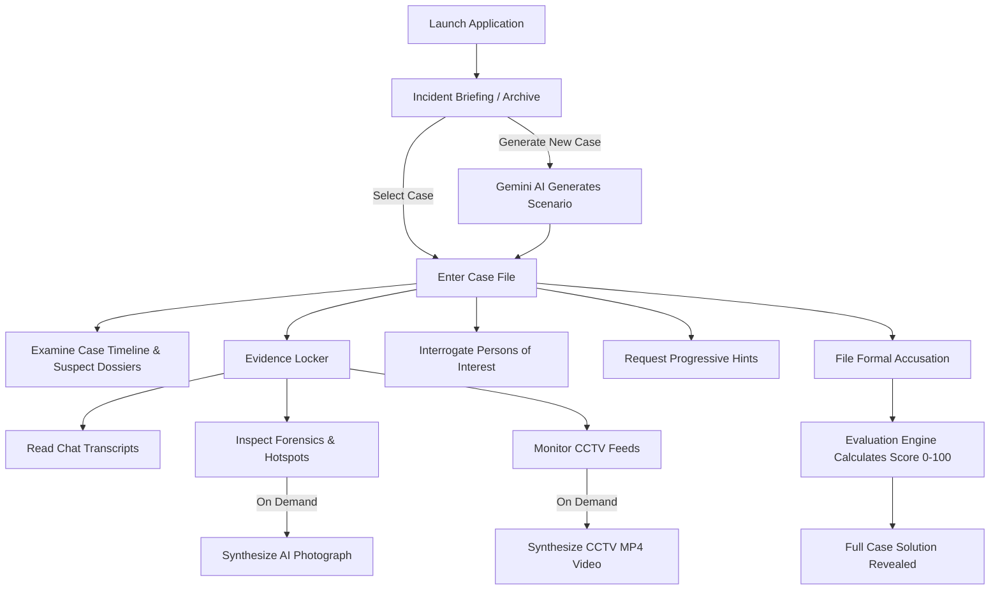

# AI Mystery Room

An immersive, noir-inspired detective investigation application where players step into the shoes of a lead investigator to solve procedural crime mysteries using forensic exhibits, communication intercepts, AI-generated evidence, suspect interrogations, and synthesized CCTV surveillance footage.

---

## Table of Contents

- [Project Overview](#project-overview)
- [Key Features](#key-features)
- [Technology Stack](#technology-stack)
- [How the Application Works](#how-the-application-works)
- [Project Architecture](#project-architecture)
- [Prerequisites](#prerequisites)
- [Installation and Setup](#installation-and-setup)
- [Environment Variables](#environment-variables)
- [API Documentation](#api-documentation)
- [AI Image and CCTV Video Generation](#ai-image-and-cctv-video-generation)
- [Testing and Verification](#testing-and-verification)
- [Troubleshooting](#troubleshooting)
- [Security and Solution Shielding](#security-and-solution-shielding)
- [Future Improvements](#future-improvements)
- [Contributing](#contributing)
- [License](#license)
- [Author and Repository](#author-and-repository)

---

## Project Overview

**AI Mystery Room** is a full-stack web application designed to bridge AI narrative generation with interactive detective gameplay. Players investigate intricate crime scenarios, examine forensic evidence, uncover hidden motives, cross-reference alibis against case timelines, and interrogate suspects in real time.

### Core Experience
- **Interactive Case Desk:** Browse archived cases or generate completely unique mystery scenarios on demand with variable difficulty tiers.
- **Evidence Locker:** Inspect recovered forensic exhibits, examine WhatsApp communication transcripts, and monitor CCTV surveillance feeds.
- **Dynamic Suspect Interrogation:** Question suspects directly using an AI-backed conversational interface where suspects stay in character, defend their alibis, and never prematurely reveal the case solution.
- **Synthesized CCTV Surveillance:** Convert static crime-scene photography into authentic, playable MP4 surveillance camera footage with zoom, scanlines, analog grain, and timeline-accurate timestamps.
- **Accusation Engine:** Formulate an accusation by naming the prime suspect and linking corroborating evidence items, earning an investigation score based on investigative accuracy.

---

## Key Features

### 1. AI-Powered Mystery Generation
- Generates coherent, multifaceted crime scenarios using Google Gemini (`gemini-3.5-flash-lite`).
- Generates culturally grounded character names, motives, alibis, detailed timelines, physical evidence items, and logical solutions.
- Enforces strict chronological event order and schema validation via Zod before persisting to the database.

### 2. Live Suspect Interrogation
- Ask custom questions to any person of interest in real time.
- Suspects respond with concise, conversational dialogue matching their personality, motives, and quirks.
- Built-in anti-leak guardrails prevent suspects from admitting guilt or revealing the solution prematurely unless cornered with indisputable proof.

### 3. Multi-Provider Forensic Image Generation
- Generates high-fidelity crime scene photographs on demand.
- **Primary AI Provider:** Cloudflare Workers AI using `@cf/black-forest-labs/flux-1-schnell`.
- **Automatic Fallback:** Gracefully falls back to Pollinations.ai or high-detail procedural vector SVG schematics if external credentials are absent or network limits are exceeded.
- Interactive numbered clue hotspots positioned over exhibits allow players to inspect physical clues.

### 4. Stage 1 CCTV Video Synthesizer
- Transforms forensic photographs and surveillance snapshots into authentic, playable **H.264 MP4 videos** using bundled FFmpeg.
- **CCTV Surveillance Effects:**
  - Ken Burns slow digital camera zoom and pan.
  - Noir surveillance color grading and contrast adjustment.
  - Analog temporal film grain (`noise`).
  - High-density scanline raster grid (`drawgrid`).
  - Phosphorescent green `(REC)` camera badge and UTC timeline timestamps (`drawtext`).
  - Glitch pulses on recordings with detected anomalies.
- Videos are stored in `server/data/media/` and streamed over HTTP with range request support for video scrubbing.

### 5. Progressive Hints and Solution Shielding
- 3-tier progressive hint system providing gradual nudges without spoiling the outcome.
- **Server-Side Sanitization:** The true culprit, motive, and solution are completely stripped from all public case queries and interrogation responses, preventing client-side inspection or reverse engineering.

### 6. Accurate Evaluation and Scoring
- Evaluates the player's final accusation against the true culprit.
- Awards up to 100 points based on correct perpetrator identification and relevant evidence correlation.
- Reveals the complete case breakdown, method, and motive only after an accusation is formally logged.

---

## Technology Stack

| Layer | Technology | Purpose / Notes |
| :--- | :--- | :--- |
| **Frontend Framework** | **React 18** | Modular UI components and interactive game screens |
| **Language** | **TypeScript 5** | Strict type safety across client and server |
| **Build Tool** | **Vite 6** | Fast development server and production bundler |
| **Styling** | **Tailwind CSS + Custom CSS** | Noir visual design, retro CRT monitors, scanlines, and glow tokens |
| **Icons** | **Lucide React** | Clean, lightweight UI iconography |
| **Backend Framework** | **Node.js + Express 4** | REST API server, static media streamer, and orchestration |
| **Runtime / Watcher** | **TSX** | TypeScript execution and live reload in development |
| **Database** | **MongoDB & Mongoose 8** | Case persistence (with automatic in-memory fallback) |
| **Schema Validation** | **Zod 4** | Input validation, case schema integrity, and sanitized payloads |
| **Text Generation AI** | **Google Gemini API** | Model `gemini-3.5-flash-lite` via `@google/genai` |
| **Image Generation AI** | **Cloudflare Workers AI** | Model `@cf/black-forest-labs/flux-1-schnell` with fallbacks |
| **Video Processing** | **FFmpeg** | Standalone static binary via `@ffmpeg-installer/ffmpeg` |

---

## How the Application Works



1. **Incident Briefing:** Review the case number, victim summary, time of death, and chronological timeline.
2. **Review Dossiers:** Inspect suspect motives, alibis, occupations, and preliminary statements.
3. **Analyze Evidence:**
   - **Messages:** Read extracted WhatsApp/SMS chats including deleted and recovered messages.
   - **Forensics:** Inspect physical exhibits and click clue markers to reveal notes.
   - **CCTV Footage:** Switch between camera angles; generate or replay synthesized surveillance video.
4. **Interrogate Suspects:** Question suspects to poke holes in their alibis while managing your deduction strategy.
5. **Request Hints:** Use up to 3 progressive hints if you encounter an investigative dead end.
6. **Submit Accusation:** Select the prime suspect, attach supporting evidence IDs, and submit for evaluation.
7. **Score & Debrief:** Receive your score (0–100) alongside the comprehensive resolution of the crime.

---

## Project Architecture

```text
AI-Mystery-Room/
├── .env.example              # Template for server configuration
├── .gitignore                # Excludes secrets, node_modules, and media storage
├── package.json              # Root workspace orchestrator (scripts: dev, build, test)
├── package-lock.json         # Locked dependency graph
├── README.md                 # Project documentation
├── spec.md                   # Detailed design & technical specification
│
├── client/                   # Frontend Workspace
│   ├── index.html            # Single-page HTML shell
│   ├── package.json          # Frontend dependencies & Vite scripts
│   ├── postcss.config.js     # PostCSS configuration
│   ├── tailwind.config.js    # Tailwind configuration
│   ├── tsconfig.json         # Frontend TypeScript configuration
│   └── src/
│       ├── App.tsx           # Main application state, views, and modals
│       ├── main.tsx          # React application entry point
│       └── style.css         # Dark noir theme, CRT screen effects, and layout
│
└── server/                   # Backend Workspace
    ├── package.json          # Backend dependencies & test scripts
    ├── tsconfig.json         # Server TypeScript compilation settings
    ├── test-cloudflare.js    # Standalone Cloudflare API verification test
    └── src/
        ├── index.ts          # Express API server, routes, and middleware
        ├── seed.ts           # Standalone database seed script
        ├── types.ts          # Core TypeScript definitions (MysteryCase, Suspect, etc.)
        ├── config/
        │   ├── db.ts         # MongoDB connection with in-memory memory map fallback
        │   └── env.ts        # Safe environment validation with credential masking
        ├── models/
        │   └── Case.model.ts # Mongoose schema for persistent mystery cases
        ├── schemas/
        │   └── case.schema.ts# Zod validation schemas for API inputs and case outputs
        ├── services/
        │   ├── case.service.ts  # Gemini mystery generator, hint engine, and scoring
        │   ├── image.service.ts # Cloudflare FLUX.1 / Pollinations / SVG image service
        │   ├── video.service.ts # Bundled FFmpeg CCTV surveillance video synthesizer
        │   └── seedCase.ts      # Offline demo case ("The Case of the Vault Breach")
        └── tests/
            ├── api.test.ts        # Comprehensive integration tests for API endpoints
            ├── cloudflare.test.ts # Cloudflare Workers AI image generation unit tests
            └── video.test.ts      # CCTV video synthesizer & URL security tests
```

---

## Prerequisites

Before running the project locally, ensure you have:

- **Node.js:** v20.0.0 or later (v22+ recommended). Check with `node -v`.
- **npm:** v10.0.0 or later. Check with `npm -v`.
- **Git:** For cloning and version control.
- **MongoDB:** *(Optional)* A local MongoDB instance or MongoDB Atlas connection string. If omitted, the server automatically runs using an in-memory database.
- **Google Gemini API Key:** *(Optional)* Required to generate new cases and interrogate suspects. The pre-seeded case works completely offline without an API key.
- **Cloudflare Workers AI Credentials:** *(Optional)* Account ID and API Token for FLUX.1 Schnell image generation. If omitted, the app automatically falls back to Pollinations.ai or procedural vector SVG schematics.

---

## Installation and Setup

### 1. Clone the Repository

```bash
git clone https://github.com/sonuprasad100e-eng/AI-Mystery-Room.git
cd AI-Mystery-Room
```

### 2. Install Dependencies

Install all root, client, and server dependencies in a single step using npm workspaces:

```bash
npm install
```

### 3. Configure Environment Variables

Copy the example environment configuration into `server/.env`:

```bash
cp .env.example server/.env
```

Open `server/.env` in your code editor and provide your API keys if you wish to use AI generation (see [Environment Variables](#environment-variables)). If left blank, the application will still run in offline demo mode.

### 4. Start Development Servers

Run both the frontend and backend concurrently with one command:

```bash
npm run dev
```

- **Backend API:** Available at `http://localhost:5000`
- **Frontend App:** Available at `http://localhost:5173`

Open `http://localhost:5173` in your browser to begin investigating!

---

## Environment Variables

All sensitive configuration is loaded exclusively on the backend (`server/.env`) and is never sent to or exposed by the client.

| Variable | Description | Required? | Default / Example |
| :--- | :--- | :--- | :--- |
| `PORT` | Port for the Express backend server | Optional | `5000` |
| `NODE_ENV` | Runtime environment (`development` / `production`) | Optional | `development` |
| `MONGODB_URI` | MongoDB connection URI. Falls back to in-memory store if unset | Optional | `mongodb://127.0.0.1:27017/ai-mystery-room` |
| `GEMINI_API_KEY` | Google Gemini API key for case generation and interrogation | Optional* | `YOUR_GEMINI_API_KEY` |
| `GEMINI_TEXT_MODEL` | Gemini text generation model identifier | Optional | `gemini-3.5-flash-lite` |
| `VITE_API_BASE_URL` | Base API URL used by the frontend | Optional | `http://localhost:5000/api` |
| `ENABLE_AI_IMAGE_GEN` | Automatically generate AI crime scene photos for new cases | Optional | `false` |
| `IMAGE_PROVIDER` | Preferred image provider (`cloudflare`, `pollinations`, `huggingface`) | Optional | `cloudflare` |
| `CLOUDFLARE_ACCOUNT_ID` | Cloudflare account ID for Workers AI | Optional** | `YOUR_CLOUDFLARE_ACCOUNT_ID` |
| `CLOUDFLARE_API_TOKEN` | Cloudflare API token with Workers AI read/write permission | Optional** | `YOUR_CLOUDFLARE_API_TOKEN` |
| `POLLINATIONS_API_KEY` | Optional key to bypass Pollinations rate limits | Optional | `YOUR_POLLINATIONS_KEY` |
| `HF_API_TOKEN` | Hugging Face user access token for HF provider | Optional | `YOUR_HF_TOKEN` |

*\* Required only to dynamically generate new mysteries or interrogate suspects in real time.*  
*\*\* Required only when `IMAGE_PROVIDER=cloudflare` is selected.*

> [!IMPORTANT]
> Never commit `server/.env` to Git. The project `.gitignore` is preconfigured to prevent sensitive configuration and media directories from being tracked.

---

## API Documentation

All routes are served under `/api` by the Express backend.

### Health and Status
- **`GET /api/health`**
  - **Purpose:** Verifies backend health, database connection state (`connected` vs `memory`), and AI service readiness.
  - **Response:**
    ```json
    {
      "status": "ok",
      "dbState": "connected",
      "aiConfigured": true,
      "imageGenEnabled": true,
      "imageProvider": "cloudflare"
    }
    ```

### Case Management
- **`GET /api/cases`**
  - **Purpose:** Lists all cases with summary metadata.
- **`POST /api/cases/generate`**
  - **Purpose:** Generates a new mystery case via Gemini.
  - **Body:** `{ "prompt": "Art museum theft during a thunderstorm", "difficulty": "hard" }`
- **`GET /api/cases/:id`**
  - **Purpose:** Retrieves a case file with the solution strictly stripped.

### Investigation & Accusation
- **`POST /api/cases/:id/interrogate`**
  - **Purpose:** Question a suspect in real time.
  - **Body:**
    ```json
    {
      "suspectId": "sus_1",
      "question": "Where were you at 23:15 when the vault alarm sounded?",
      "history": []
    }
    ```
- **`POST /api/cases/:id/hint`**
  - **Purpose:** Returns progressive hints (Step 1, 2, or 3).
  - **Body:** `{ "step": 1 }`
- **`POST /api/cases/:id/solve`**
  - **Purpose:** Submits an accusation and calculates a score (0–100).
  - **Body:**
    ```json
    {
      "suspectId": "sus_1",
      "selectedEvidenceIds": ["ev_photo_1", "ev_cctv_1"]
    }
    ```

### Media Generation
- **`POST /api/cases/:id/evidence/:evidenceId/generate-image`**
  - **Purpose:** Generates or regenerates an AI photograph for a specific forensic exhibit.
- **`POST /api/cases/:id/cctv/:evidenceId/generate-video`**
  - **Purpose:** Renders a 6-second CCTV MP4 video for a specific camera angle.
  - **Body:** `{ "force": false }`
- **`GET /api/media/:filename`**
  - **Purpose:** Serves cached images and streams MP4 videos with `Range` header support.

---

## AI Image and CCTV Video Generation

The application maintains two distinct, decoupled media synthesis systems:

```text
┌────────────────────────────────────────────────────────┐
│               1. AI Forensic Image Pipeline            │
│  Case Evidence Prompt ──► Cloudflare FLUX.1 Schnell    │
│                       ──► Fallback: Pollinations.ai    │
│                       ──► Fallback: Procedural SVG     │
│                       └──► Stored as JPEG/PNG/SVG      │
└────────────────────────────────────────────────────────┘

┌────────────────────────────────────────────────────────┐
│            2. Stage 1 CCTV Video Synthesizer           │
│  Forensic Image/Snapshot ──► Bundled FFmpeg            │
│                          ──► Ken Burns Zoom / Pan      │
│                          ──► Scanlines & Film Grain    │
│                          ──► Timestamp & REC Badges    │
│                          ──► Glitch on Anomaly Frame   │
│                          └──► Stored as 6-sec H.264 MP4│
└────────────────────────────────────────────────────────┘
```

### Clarification on Video Generation (Stage 1 vs Stage 2)
- **Stage 1 (Implemented):** Uses a deterministic, bundled FFmpeg filtergraph to turn forensic photographs and snapshot frames into genuine, playable surveillance video footage. It features realistic camera panning, temporal film grain, noise, raster scanlines, phosphorescent overlays, and anomaly glitches. **It does not generate novel AI-synthesized human movement.**
- **Stage 2 (Planned):** Integration of a genuine image-to-video deep-learning model (such as Stable Video Diffusion or open-access video APIs) when free, reproducible endpoints become available.

---

## Testing and Verification

The project includes an automated test suite verifying schemas, API endpoints, AI image generation, and FFmpeg video synthesis.

### Run Tests

Execute the full test suite from the repository root:

```bash
npm test
```

*Or directly inside the server directory:*

```bash
npm test -w server
```

### Verified Test Results
```text
✔ GET /api/health returns 200 with status and configuration state
✔ GET /api/cases lists cases with summary metadata
✔ GET /api/cases/:id retrieves case with solution strictly shielded
✔ POST /api/cases/:id/hint returns progressive hints and handles bounds
✔ POST /api/cases/:id/solve evaluates correct accusation and calculates 100 score
✔ POST /api/cases/:id/evidence/:evidenceId/generate-image handles on-demand generation
✔ POST /api/cases/:id/interrogate handles valid suspect inquiry and shields solution
✔ generateEvidenceImage with Cloudflare FLUX.1 Schnell generates and saves real photograph
✔ isAllowedUrl validates relative /api/media/ video paths and rejects malicious schemes
✔ getFfmpegPath returns an existing binary on the system
✔ POST /api/cases/:id/cctv/:evidenceId/generate-video synthesizes a genuine CCTV MP4 video
✔ generateCctvVideo reuses existing video without re-rendering when force is false

ℹ tests 35 | pass 35 | fail 0
```

### Validate Production Builds

```bash
npm run build
```
Compiles both the backend TypeScript bundle (`tsc`) and the frontend production bundle (`tsc -b && vite build`).

---

## Troubleshooting

### 1. Port 5000 is already in use
If another process is using port 5000, specify a different port in `server/.env`:
```env
PORT=5001
```
And adjust `VITE_API_BASE_URL=http://localhost:5001/api` accordingly. On Windows PowerShell, you can terminate the blocking process using:
```powershell
Get-Process -Id (Get-NetTCPConnection -LocalPort 5000).OwningProcess | Stop-Process -Force
```

### 2. MongoDB connection refused
If MongoDB is not installed or running locally, **do not worry**: the server automatically falls back to an in-memory memory store. All features (including generating and solving cases) will function normally for the duration of the server session.

### 3. Missing or invalid Gemini API Key
If `GEMINI_API_KEY` is empty or invalid, case generation and suspect interrogation will return a user-friendly error. The built-in demo mystery (*The Case of the Vault Breach*) will remain fully playable offline.

### 4. Cloudflare Workers AI returned 400 (NSFW filter or rate limit)
Cloudflare's FLUX.1 Schnell model enforces a strict content moderation filter. If a prompt triggers the filter or your Cloudflare credentials expire, the application automatically and gracefully falls back to Pollinations or procedural SVG schematics without interrupting gameplay.

### 5. FFmpeg execution errors
Stage 1 video generation uses the bundled binary from `@ffmpeg-installer/ffmpeg` located in `node_modules`. No global system FFmpeg installation or `PATH` variable modification is necessary.

---

## Security and Solution Shielding

1. **Strict Solution Shielding:** The case solution (true culprit, exact motive, secret mechanism) is never delivered to the client during active gameplay. All `GET /api/cases/:id` responses pass through a sanitization filter that strips the `solution` block.
2. **Interrogation Guardrails:** Suspect prompts include strict system instructions preventing the language model from leaking confidential case details or confessing unless challenged with conclusive evidence.
3. **No Frontend Secrets:** All API keys (Gemini, Cloudflare, Pollinations) are stored on the server. The Vite frontend never bundles or receives secret keys.
4. **Path Traversal Protection:** The media streamer only serves files from `server/data/media/` and rejects arbitrary filesystem paths.

---

## Future Improvements

- **Stage 2 AI Video Generation:** Integration of an open image-to-video AI model for genuine character movement and temporal animations.
- **Voice Interrogation:** Browser-based speech-to-text and text-to-speech suspect interactions.
- **Multiplayer Co-Op:** Shared detective room where multiple investigators inspect clues and vote on accusations simultaneously.
- **More Mystery Themes:** Cyber-heists, Victorian murder mysteries, espionage, and cold cases.

---

## Contributing

Contributions, bug reports, and suggestions are welcome!

1. Fork the repository.
2. Create a feature branch: `git checkout -b feature/my-new-feature`.
3. Commit your changes: `git commit -m "feat: add new feature"`.
4. Ensure all tests pass: `npm test`.
5. Push to the branch: `git push origin feature/my-new-feature`.
6. Open a Pull Request.

---

## License

No license has been specified for this project yet. All rights are reserved by the repository owner.

---

## Author and Repository

- **GitHub Repository:** [https://github.com/sonuprasad100e-eng/AI-Mystery-Room.git](https://github.com/sonuprasad100e-eng/AI-Mystery-Room.git)
- **Author:** [sonuprasad100e-eng](https://github.com/sonuprasad100e-eng)
